# QueueTheMagic

[](https://hub.docker.com/r/thebradleysanders/queue-the-magic)

A real-time holiday light show app that lets your neighbors **request songs, cheer, donate and listen live** from their phones. Visitors pay through Stripe to queue songs played by [Falcon Player (FPP)](https://falconchristmas.com/), and a default playlist runs in between. It includes an admin dashboard with live queue management, reports, MQTT integration and more.

**Built by [Brad Sanders](https://github.com/thebradleysanders)**

## Goal
I often get asked
 * 'how can I donate?'
 * 'how can I see the song list, when can I see it?'
 * 'I love x song from last year, can I see it again?'

I have solved this with a simple self-hosted website users can access from social media or by simply scanning a QR code, for example on a yard sign. It also gives the audience ways to take part in the show, and gives you ways to fund it.

---

## Screenshots

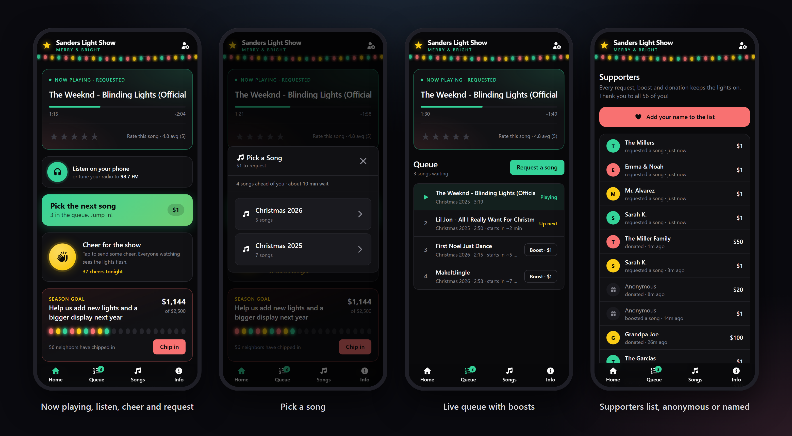

<table>
  <tr>
    <td align="center">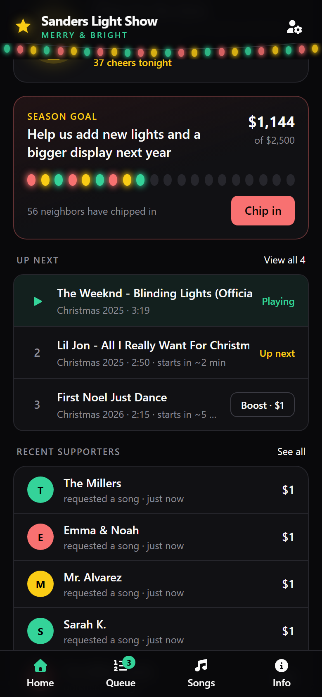<br><sub>Season donation goal, queue and supporters</sub></td>
    <td align="center">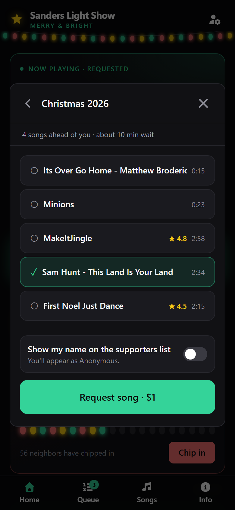<br><sub>Requesting a song</sub></td>
    <td align="center">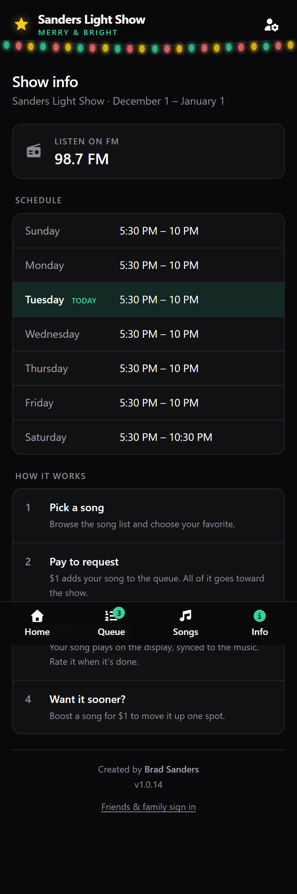<br><sub>Show info and schedule</sub></td>
  </tr>
  <tr>
    <td align="center">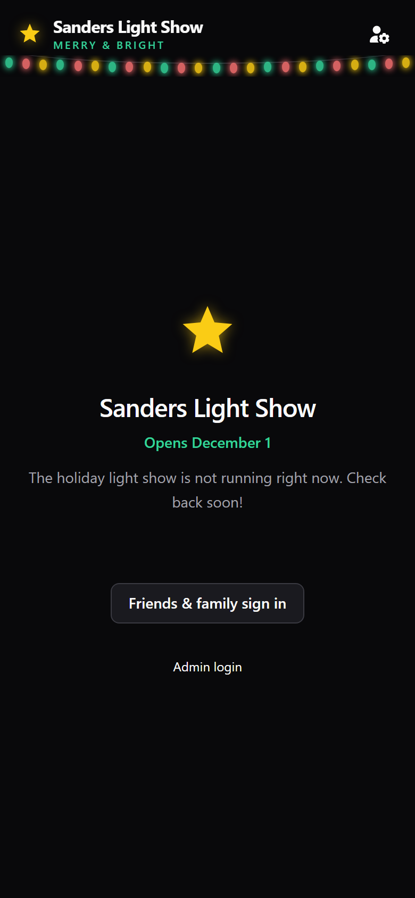<br><sub>Before the season opens</sub></td>
    <td align="center">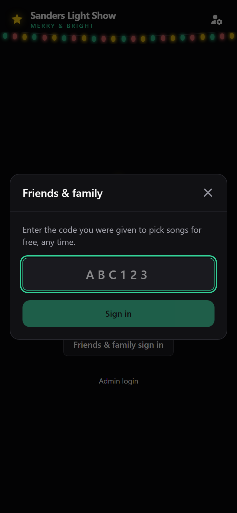<br><sub>Friends &amp; family sign in</sub></td>
    <td align="center">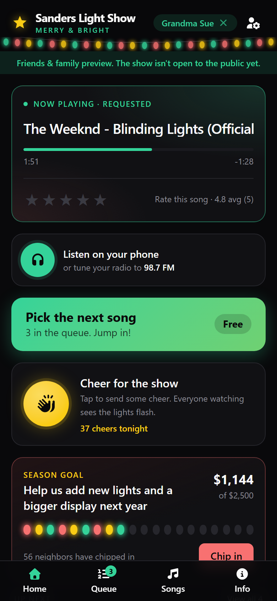<br><sub>Friends &amp; family preview</sub></td>
  </tr>
</table>

**Admin dashboard**

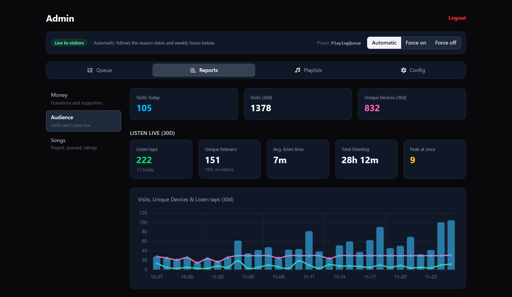

<table>
  <tr>
    <td>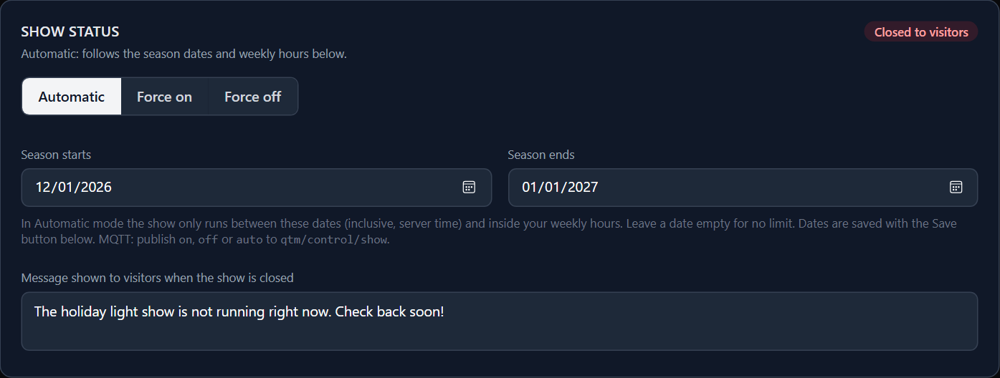<br><sub>Season dates and the manual on/off override</sub></td>
    <td>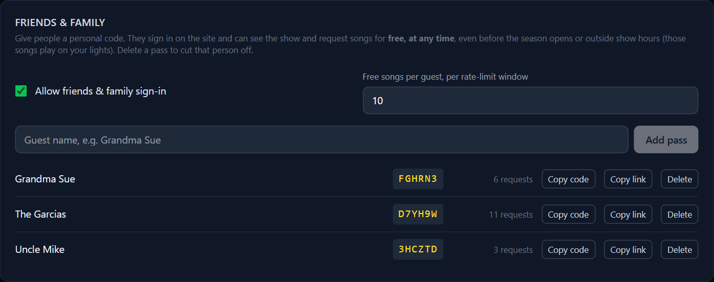<br><sub>Friends &amp; family passes</sub></td>
  </tr>
  <tr>
    <td>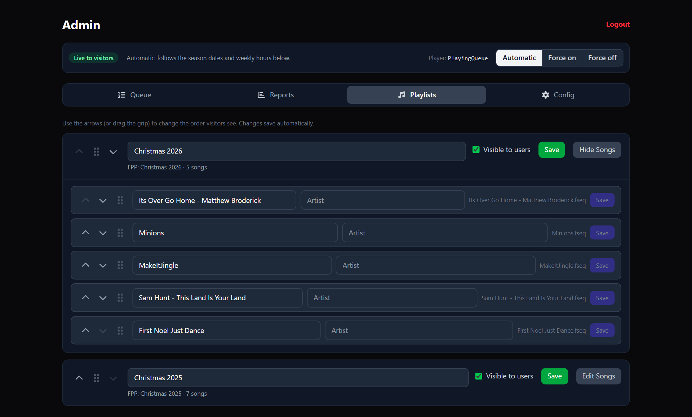<br><sub>Reorder playlists and songs</sub></td>
    <td>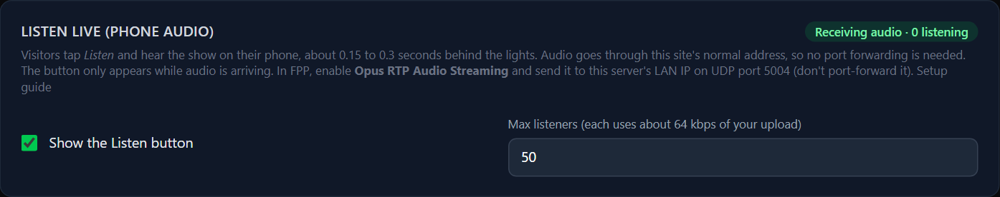<br><sub>Listen live settings</sub></td>
  </tr>
</table>

## Features

**For your visitors**
- Song requests with [Stripe](https://stripe.com/) payment (price set by you), and a **boost** to move a song up the queue
- "Just Because" donations (no song required)
- **Season donation goal** shown as a string of lights that fill up as you get closer
- **Supporters list**: every request, boost and donation, with amounts. Visitors choose whether to show a name; the default is Anonymous
- **Cheer button**: a free tap that flashes the lights on every visitor's phone (and can trigger real props over MQTT)
- **Live activity pop-ups** ("Someone requested Carol of the Bells") so people can see others joining in
- **Listen live**: show audio on the phone, in sync with the lights, with no port forwarding ([guide](docs/LISTEN.md))
- Live queue and now-playing with progress, wait estimates and song ratings
- Dark, mobile-first design with an accent colour that follows the season (see [Seasonal Themes](#seasonal-themes))

**For you**
- **Season start/end dates** plus a weekly schedule. Nothing plays or can be requested outside them
- **Manual override** (Automatic / Force on / Force off) in the admin, or by MQTT
- Schedule hours can be clock times or **Dawn / Sunrise / Sunset / Dusk** (with FPP offsets), and overnight windows work
- **Friends & family passes**: give people a personal code to sign in, see the show before it opens and pick songs for free, any time
- Reorder playlists and songs, hide playlists, rename songs
- Automatic refunds if a paid request can't be fulfilled
- Admin dashboard: reports (donations, songs, visitors, listen stats, ratings), live queue, diagnostics, supporters moderation, **Reset stats**
- FPP integration: controls playback directly, imports sequences, playlists and the schedule
- MQTT events and remote control for Home Assistant, signs, props and more ([guide](docs/MQTT.md))

---

## Docker Setup

### Prerequisites

- [Docker](https://docs.docker.com/get-docker/) and Docker Compose
- A [Stripe](https://stripe.com) account (test keys work fine for development)
- [Falcon Player](https://github.com/FalconChristmas/fpp) running on your network
- A reverse proxy like [Traefik](https://github.com/traefik/traefik) or [Nginx Proxy Manager](https://github.com/NginxProxyManager/nginx-proxy-manager), for HTTPS (Required for [Stripe](https://stripe.com))
    - Ensure websocket support is enabled (the live queue and Listen live need it).

### 1. Create a docker-compose.yml

Create a new folder and add this file, no repo clone needed:

```yaml
services:
  app:
    image: thebradleysanders/queue-the-magic:latest
    container_name: qtm
    ports:
      - "80:80"
      - "5004:5004/udp"   # Listen live (optional): FPP sends audio here. LAN only, never port-forward it
    environment:
      - Stripe__SecretKey=sk_live_...
      - Stripe__PublishableKey=pk_live_...
      - AdminPassword=your-secure-password
      - Jwt__Secret=change-this-to-a-long-random-string-min-32-chars
      - AllowedOrigins=https://your-domain.com
      - TZ=America/Chicago   # your time zone: season dates and show hours use the server's clock
    volumes:
      - qtm-data:/app/data
    restart: unless-stopped

volumes:
  qtm-data:
    name: qtm-data
```

### 2. Start the container

```bash
docker compose up -d
```

### 3. First-time setup

1. Open `http://your-server-ip` and the public site is live
2. Go to `http://your-server-ip/admin` and log in with your `AdminPassword`
3. In **Config → Falcon Player (FPP)**:
   - Verify the FPP Address matches your player
   - Click **Import Playlists** and **Import Sequences** to sync your FPP library
   - Select your **Default Playlist** from the dropdown
4. In **Config → Show status**, set the **season start and end dates**. Leave the switch on **Automatic**
5. Set your **weekly show schedule** (or click **Import from FPP**). If it uses Dusk or Sunset times, enter your latitude and longitude
6. Set your site name, FM station, pricing and (optionally) a **season donation goal**
7. Click **Save Configuration**
8. Optional: turn on [Listen live](docs/LISTEN.md), [MQTT](docs/MQTT.md), and create [friends & family passes](#friends--family)

### Useful commands

```bash
# View logs
docker compose logs -f

# Stop
docker compose down

# Stop and delete all data
docker compose down -v

# Pull latest images and restart
docker compose pull && docker compose up -d
```

### Upgrading

Database changes are applied automatically when the new version starts. **Back up the `qtm-data` volume first** (see [Data Persistence](#data-persistence)), then `docker compose pull && docker compose up -d`. The version you are running is shown at the bottom of the public **Info** page.

---

## Environment Variables

All configuration is passed via environment variables, no config files to edit.

| Variable | Default | Description |
|---|---|---|
| `Stripe__SecretKey` | - | Stripe secret key (server-side) |
| `Stripe__PublishableKey` | - | Stripe publishable key (returned to frontend via API) |
| `AdminPassword` | - | Password for `/admin` login. **Required**, min 8 characters |
| `Jwt__Secret` | - | Token signing secret. **Required**, min 32 characters, keep private (`openssl rand -base64 48`) |
| `AllowedOrigins` | `https://localhost` | CORS origin (your domain or IP) |
| `TZ` | `UTC` | Your time zone, e.g. `America/Chicago`. Season dates, weekly hours and Dusk/Sunset times use this |
| `Listen__RtpPort` | `5004` | UDP port FPP sends Opus RTP audio to, for [Listen live](docs/LISTEN.md). Change the `ports:` mapping to match |

> In production the app **refuses to start** if `AdminPassword` or `Jwt__Secret` is missing, too short, or a well-known placeholder (`changeme`, `change-this…`). This is deliberate, so a live site can never run with default credentials.

> FPP address and all other show settings are configured via the admin dashboard and stored in the database.

---

## Show schedule, season and override

The public site and the queue follow three layers, from highest priority:

1. **Manual override** (Admin → Config → Show status):
   - **Automatic**: follow the season dates and weekly hours.
   - **Force on**: the show runs now, ignoring dates and hours.
   - **Force off**: the show is closed.
   - Also settable over MQTT (`<prefix>/control/show` with `on`, `off` or `auto`). A yellow banner reminds you when it isn't Automatic.
2. **Season dates**: before the start date visitors see a closed page with "Opens December 1". After the end date it closes again.
3. **Weekly hours**: outside them requests are refused and the default playlist stops.

The default playlist only starts when the season is open **and** inside the weekly hours, and (if you enabled it) when **Auto play default playlist** is on. A schedule time that can't be worked out (for example Dusk with no location set) counts as closed, so nothing ever runs outside your real schedule.

### Friends & family

Create a pass per person in **Admin → Config → Friends & family**. Each pass has a short code (and a "Copy link" link like `https://your-site/?guest=ABC123` that signs the person in automatically). Guests can see the whole site before the season opens and request songs **for free, at any time**, and those songs play on your lights even outside the public hours. Delete a pass to cut that person off immediately. Guest requests create no payment records.

---

## Seasonal Themes

The accent colour follows the calendar, no configuration needed:

| Dates | Theme |
|---|---|
| Oct 1 – Nov 3 | 🎃 Halloween |
| Nov 4 – Nov 14 | 🍁 Autumn |
| Nov 15 – Dec 31 | 🎄 Christmas |
| Jan 1 – Jan 31 | ⛄ Winter |
| Feb 1 – Feb 14 | 💝 Valentine's Day |
| Mar 1 – Mar 17 | 🍀 St. Patrick's Day |
| Mar 18 – May 31 | 🌷 Spring |
| Jun 25 – Jul 6 | 🎆 4th of July |
| Any other time | ✨ Default |

Preview any theme by adding `?season=` to the URL, e.g. `https://your-site/?season=halloween`. Dates and colours live in `web/src/composables/useSeason.js` and `web/src/assets/main.css`.

---

## MQTT

Optional, one-way events plus one control topic. Full guide with Home Assistant examples: **[docs/MQTT.md](docs/MQTT.md)**.

| Topic (`<prefix>/…`) | Sent when |
|---|---|
| `songqueued` | Someone requests a song |
| `donation` | A "Just Because" donation |
| `nowplaying` | A requested song starts or finishes |
| `visit` | A device opens the site (once per device per 30 minutes) |
| `cheer` | Someone taps the cheer button |
| `status` | The show mode or config changes (retained) |
| `control/show` | **You publish** `on`, `off` or `auto` to switch the show |
| `test` | You press the test button in admin |

---

## Security Notes

- Every payment is verified server-side with Stripe: it must have succeeded, match the type (song / boost / donation) and the specific song, cover the configured price, and can only be redeemed **once**. Donation amounts come from Stripe, never from the browser. If a paid request can't be fulfilled it is refunded automatically.
- Admin login, friends & family sign-in, payment-intent creation, ratings, cheers and Listen live are rate limited per client IP. nginx only trusts `X-Forwarded-For` from private-network proxies.
- Guest tokens use a separate signing key and header, so they can never be used as an admin token. Supporter names are cleaned (length, control characters) and always rendered as text; you can hide any name from the Reports tab.
- nginx sends a Content-Security-Policy (own assets + Stripe only), `nosniff`, frame and referrer protections. If you add third-party scripts or fonts, extend the CSP in `docker/nginx.conf.template`.
- Visitor, listener and supporter statistics are anonymous: only a random per-browser ID is stored, never an IP address.
- Terminate HTTPS at your reverse proxy and enable HSTS there.
- Admin tokens last 8 hours. Rotate `Jwt__Secret` to sign everyone out.

---

## Data Persistence

All data (songs, queue history, donations, ratings, statistics, configuration) is stored in a named Docker volume `qtm-data`. It survives container restarts and image updates.

**Backup:**
```bash
docker run --rm -v qtm-data:/data -v $(pwd):/backup alpine \
  tar czf /backup/qtm-backup.tar.gz -C /data .
```

**Restore:**
```bash
docker run --rm -v qtm-data:/data -v $(pwd):/backup alpine \
  tar xzf /backup/qtm-backup.tar.gz -C /data
```

---

## FPP Integration

QueueTheMagic communicates directly with your Falcon Player over HTTP. Make sure:

- FPP is reachable from the Docker host at the IP set in the admin (**Falcon Player (FPP)** section)
- FPP API is enabled (it is by default on all FPP installs)
- After adding or removing sequences in FPP, click **Import Playlists** / **Import Sequences** in the admin config to re-sync. New items are added to the end of your display order

The app polls FPP every 5 seconds (configurable in admin). When a user song is queued, the poller wakes immediately and starts playback. When the song ends, the default playlist resumes automatically. Playback commands use `POST` first (required from FPP 10.3 onward, where state-changing `GET` requests are deprecated) and fall back to `GET` for older versions.

For **Listen live**, enable **Opus RTP Audio Streaming** in FPP's PipeWire audio network stream settings and send it to the QTM server on UDP 5004. See [docs/LISTEN.md](docs/LISTEN.md).

---

### Local development (without Docker)

**Backend:**
```bash
cd api
dotnet restore
dotnet run   # http://localhost:5288
```

**Frontend:**
```bash
cd web
npm install
npm run dev  # http://localhost:5173 (proxies /api and the websockets to :5288)
```

In development the API runs in **Development** mode: payments are simulated (no Stripe keys needed) and the admin password is `changeme`. These shortcuts are disabled in Docker/production.

---

## Stack

- **Backend**: ASP.NET Core 9, SQLite, Entity Framework Core, SignalR, WebSockets, Stripe.net, MQTTnet
- **Frontend**: Vue 3, Pinia, PrimeVue, Tailwind CSS v4, Vite, Opus audio decoding (WebAssembly)
- **Infrastructure**: Docker, nginx, SQLite

---

## License

MIT
